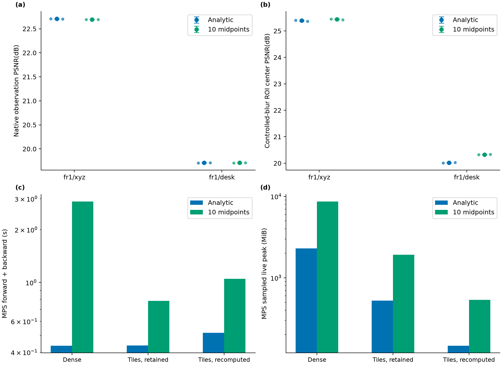
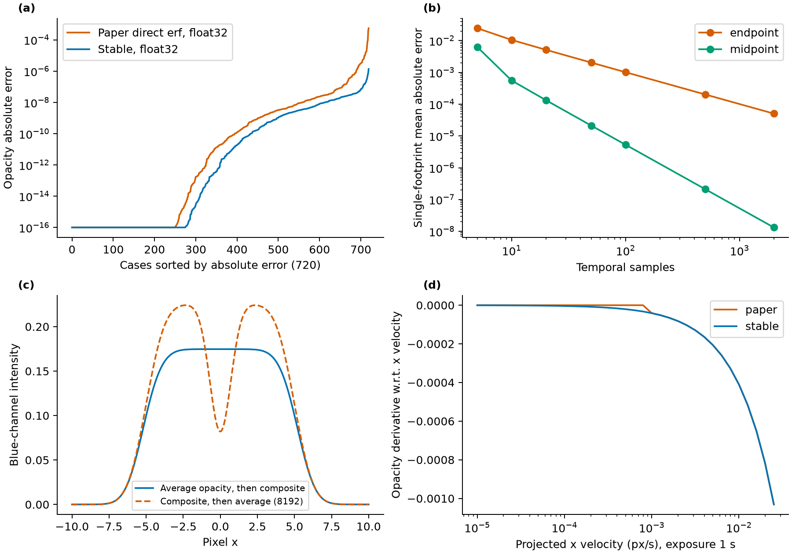
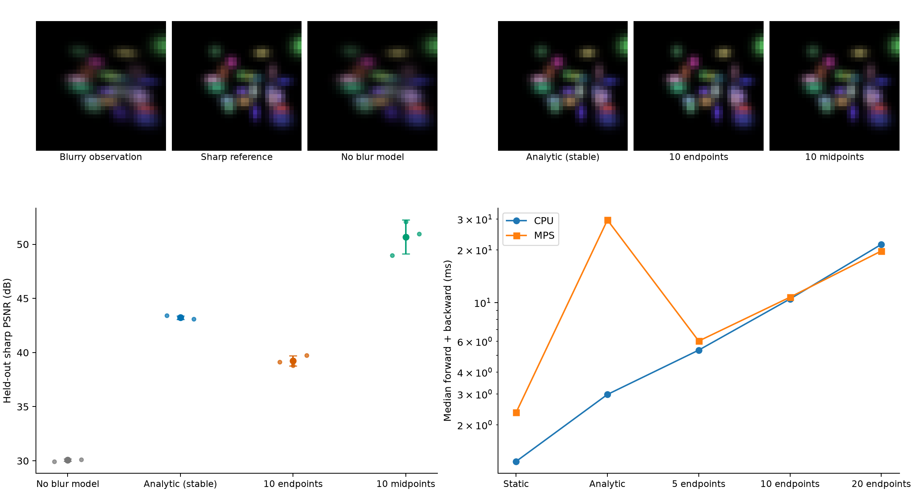

<div align="center">

<h1>RoMo-GS: Efficient Online 3D Gaussian Splatting for Robot Mapping via Exposure-Integrated Motion Blur [Reproduction]</h1>

<p><strong>Exposure integration · Checkpointed tiles · Real RGB-D pilot</strong></p>

<p>
<a href="https://arxiv.org/abs/2610.24605"></a>


</p>

<p><a href="docs/phase2_results.md">📊 RGB-D results</a> · <a href="docs/phase2_protocol.md">🧪 Protocol</a> · <a href="docs/method.md">📐 Core method</a> · <a href="docs/phase2_rebuild.md">📦 Rebuild</a> · <a href="COVERAGE.md">🔍 Coverage</a></p>
</div>

Independent implementation based on arXiv:2610.24605v1. The official project page still marked algorithm code “TBD” at the initial review. This local project implements the exposure-integration core and controlled 3D reconstruction; it is not the authors' complete online robot mapping system.

| Status | Scope |
|---|---|
| **Implemented** | Original/stabilized exposure integrals, calibrated projection, conservative swept-support tiles, Gaussian streaming, batched midpoint sampling, per-tile backward recomputation and training-only RGB-D initialization. |
| **Validated locally** | Core:720 integral/24 gradient/224 near-static cases and24 synthetic fits. Phase two:16tests,28 real RGB-D fits,20 isolated initializer profiles and12 final-map profiles; all final parameters replayed. |
| **Remaining gaps** | Known mocap poses, short fixed-count pilots, restrictive controlled ROI and incomplete broader-area reconstruction. No ORB-SLAM3/MODP, online LM/pruning/densification, fused rasterizer or original paper table match. |

## 📊 Phase two: tiled rendering and real RGB-D



Two public TUM sequences, each15frames (10train/5held out),2400Gaussians,96×72 and150steps. MPS uses3paired color-initialization seeds for both native and controlled-blur tracks; CPU adds4seed0controlled checks. Training geometry and colors use only training observations; controlled colors never use the pre-blur reference.

Controlled-blur ROI PSNR, mean±sampleSD over3MPS seeds:

| Sequence | Analytic(dB) | 10midpoints(dB) | Broader valid-depth centerPSNR, analytic / midpoint(dB) |
|---|---:|---:|---:|
| fr1/xyz |25.389±0.021 |25.443±0.018 |15.545 /15.577 |
| fr1/desk |20.017±0.007 |20.323±0.008 |13.049 /13.379 |

Midpoints are slightly better on these controlled ROIs. The broader-area scores and local qualitative figure expose substantial reconstruction gaps. Controlled masks cover only9.6–39.2% of image pixels, depending on frame; native depth-valid masks cover approximately70–80%. Native exposure1/60s is an assumption, and original RGB is not independently sharp sensor ground truth. This is a real-data feasibility pilot, not complete online mapping.

Four CPU/GPU pixel-gate exceptions are retained: near-depth rounding changes compositing order. OriginalGPU self-replays are exact, while CPU PSNR differs by at most3.49e−5dB. The strict pixel gate is unchanged; the report includes the causal controls instead of hiding the exceptions.

In the matched initialized-view benchmark (2400Gaussians/96×72), MPS sampled live peaks drop from2292to146MiB for analytic rendering and8645to535MiB for10midpoints with tiled recomputation. Analytic full forward/backward takes0.516s versus0.436s dense; midpoints take1.048s versus2.891s dense. The memory/compute tradeoff is explicit. These are isolated renderer measurements; final trained-map inference and resource records are reported separately, not extrapolated from initialization.

[Full results and negative cases](docs/phase2_results.md) · [Exact protocol](docs/phase2_protocol.md) · [Download/replay/retrain](docs/phase2_rebuild.md) · [Representative3D point maps](results/phase2/maps/index.json)

Original/processed RGB-D input caches remain local and are excluded from Git and the deliveryZIP. The ZIP includes all code, configurations, logs, full-precision Gaussian parameters,28model-rendered output archives and final figures. Public collection materials contain only reviewed scalar results and an aggregate preview.

## 📊 Phase one: core verification and synthetic pilot

[Historical phase-one report](docs/results.md). These settings and results are retained separately from the larger real-data stage.



Stable float64 integral error against independent adaptive quadrature: maximum2.11e−15. Gradient error against quadrature finite differences: maximum6.85e−11. Direct float32 erf evaluation is less accurate in the stress suite; original and stabilized variants are both retained.



On one synthetic scene (24 Gaussians,32×32,6 training and3 held-out views), MPS sharp held-out PSNR over3 seeds is30.066±0.104dB without blur modeling,43.225±0.159dB with analytic integration,39.234±0.481dB with10 endpoints, and50.674±1.568dB with10 midpoints. Values are generated and checked in [the full report](docs/results.md); these are not original paper benchmarks. Known cameras, fixed count and near-GT initialization substantially simplify the task.

The opacity integral is accurate, but averaging individual opacities before compositing is a model approximation. A high-opacity two-layer stress case produces maximumRGB difference0.0927 against time-averaged compositing. The midpoint control also outperforms the analytic model in this reconstruction pilot. Current dense PyTorch MPS execution is slower than CPU at this scale; no claim is made about the paper's NVIDIA speedups.

## 🛠️ Installation

```sh
python3.12 -m venv .venv
source .venv/bin/activate
python -m pip install -r requirements-lock.txt
python -m pip install --no-deps --no-build-isolation -e .
```

Use CPU on any supported machine. `--device mps` requires an Apple Silicon Mac and available PyTorch MPS; failure does not silently fall back. No OpenAI API, external credentials or pretrained weights are used.

## 🧪 Rebuild the phase-one experiments

For the real RGB-D stage, use [the phase-two rebuild guide](docs/phase2_rebuild.md).

Run from this directory. Saved results can be inspected without re-running training.

```sh
python -m pytest -q
python scripts/validate_core.py
python scripts/pilot.py --device cpu --methods static analytic sampled
python scripts/pilot.py --device mps --methods static analytic sampled
python scripts/pilot.py --device cpu --methods sampled_midpoint --output results/midpoint_cpu
python scripts/pilot.py --device mps --methods sampled_midpoint --output results/midpoint_mps
python scripts/device_audit.py
python scripts/audit_limits.py
python scripts/report.py
python scripts/replay.py
python scripts/manifest.py
python scripts/manifest.py --check
```

`pilot.py` generates `results/pilot_scene.npz` deterministically when absent and otherwise uses that cache. To regenerate observations, remove only that file before running one pilot (do not launch simultaneous data generation). Re-running a script overwrites its named output; choose `--output` to preserve alternative runs. Training24 runs takes minutes or less on the tested Mac, but timing is machine-dependent. `report.py` expects both devices and the four named output folders shown above; core verification itself does not require MPS.

The paper HTML is a local source cache excluded from Git. To reproduce its provenance check, download the fixed version:

```sh
curl -L --fail https://arxiv.org/html/2610.24605v1 -o paper/paper.html
```

Core validation works without the HTML cache; provenance metadata records its absence. The original content remains subject to its original license. `paper/source.json` records the reviewed URL and digest, and no paper HTML is included in the deliverable archive.

## 📁 Data, code and evidence

- [Tiled backend](romo_gs/tiled.py), [phase-two protocol](docs/phase2_protocol.md), [real-data aggregate](results/phase2/aggregate.json), [final-model profiles](results/phase2/final_profiles), [phase-two replay](results/phase2/replay.json) and [final audit](results/phase2/final_audit.json).
- [RGB-D source hashes and frame selection](results/phase2/freiburg1_xyz_source.json); both reviewed sequences have corresponding manifests. Original observations are downloaded/rebuilt, not redistributed.
- [Core](romo_gs/core.py): equations, projection, opacity and renderer.
- [Protocol](docs/protocol.md) and [method](docs/method.md): parameters, reference methods, numerical extensions and assumptions.
- [Raw integral and gradient cases](results/core/core_raw.json), [device audit](results/device_audit.json), [limits audit](results/limits_audit.json).
- [Training aggregate](results/aggregate.json), per-step logs and24 parameter archives in `results/pilot_*/` and `results/midpoint_*/`.
- [Procedural scene](results/pilot_scene.npz): original parameters, views, sharp references and independently integrated observations. No third-party raw images are redistributed.
- [Replay](results/replay.json), [environment](results/environment.json), [dependency lock](requirements-lock.txt), [SHA-256 manifest](results/manifest.json).
- PNG and vector PDF versions of both figures are under `results/`.

## 🔎 Coverage and limitations

See [COVERAGE.md](COVERAGE.md). All paper tables remain unmatched. Phase two adds actual training-depth initialization and tiled Mac execution, while still using known camera poses, fixed Gaussian count, constrained covariance and a short budget. Wider scene coverage, fused kernels, learned camera corrections and online map management remain outside the completed pilot.

## 📚 Reproduction collection

[Collection repository](https://github.com/gulucaptain/Research-Reproductions) · [Public project page](https://research-reproductions.gulucaptain666.chatgpt.site). This independent repository publishes the implementation and reviewed results; the collection links a pinned release commit.

## Publication and provenance

See [publication scope](docs/publication.md), [research snapshot and omitted artifacts](PUBLICATION.json), and [public file hashes](PUBLICATION_FILES.json). Raw external data, third-party pretrained weights and virtual environments are not included.
