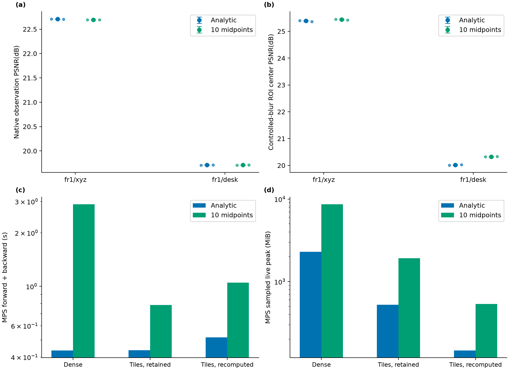
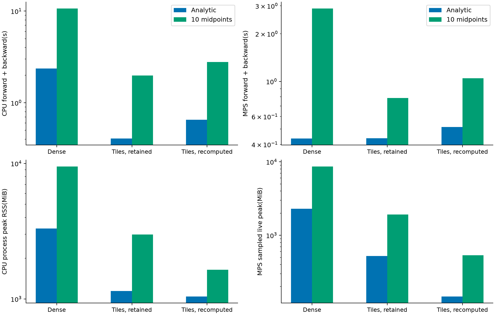

# RoMo-GS 第二阶段：分块渲染与真实 RGB-D 小规模重建

审阅日期：2026-11-17。独立实现；本阶段完成分块渲染、公开TUM RGB-D接入、解析积分/中点采样的局部重建与资源对照。未复现完整在线系统或论文结果表。

## 实验范围

- TUM `freiburg1_xyz`、`freiburg1_desk`各15帧：10训练、5留出；每序列2400高斯、96×72、固定mocap相机、150步。MPS两方法×两轨道×两序列×3种子=24次；CPU受控轨道种子0的4次配对验证，共28次。
- 原生轨道：曝光1/60s是披露的假设，评估预测观测对原始RGB，不能声称真实传感器去模糊成功。受控轨道：在真实RGB-D上添加0.08s已知模糊，独立深度重投影生成标签；原始RGB是添加模糊前参考，仍可能含原生模糊。
- 初始化仅用训练RGB-D。受控轨道的颜色只从模糊训练观测取得；测试RGB/深度不进入初始化或优化。位置±3cm、尺度变化范围固定；是已知位姿的离线小规模重建，不是未知位姿在线SLAM。
- 受控轨道只在固定、全曝光都有效的重投影ROI训练/主要评估，同时报告全部有效深度像素上的中心渲染PSNR，保留ROI外的不足。没有通过预测质量筛像素。

## 图像与几何质量

主表为MPS三个种子的均值±样本标准差。原生与受控轨道的参考和mask不同，不能横向比较绝对PSNR来宣称去模糊收益。

| 序列 | 轨道 | 方法 | 主要PSNR(dB) | SSIM | 全有效深度区域中心PSNR(dB) | 深度RMSE(m) | Alpha>0.9覆盖率 |
|---|---|---|---:|---:|---:|---:|---:|
| freiburg1_xyz | native | Analytic | 22.7065 ± 0.0026 | 0.8998 ± 0.0001 | 22.6947 ± 0.0026 | 0.1794 ± 0.0001 | 0.8480 ± 0.0016 |
| freiburg1_xyz | native | 10 midpoints | 22.6933 ± 0.0020 | 0.8994 ± 0.0001 | 22.6946 ± 0.0019 | 0.1794 ± 0.0001 | 0.8475 ± 0.0020 |
| freiburg1_xyz | controlled | Analytic | 25.3889 ± 0.0206 | 0.8254 ± 0.0001 | 15.5453 ± 0.0068 | 0.0515 ± 0.0001 | 0.8884 ± 0.0006 |
| freiburg1_xyz | controlled | 10 midpoints | 25.4434 ± 0.0178 | 0.8278 ± 0.0005 | 15.5767 ± 0.0102 | 0.0522 ± 0.0002 | 0.8771 ± 0.0004 |
| freiburg1_desk | native | Analytic | 19.7122 ± 0.0043 | 0.8340 ± 0.0001 | 19.7063 ± 0.0044 | 0.2523 ± 0.0001 | 0.7455 ± 0.0005 |
| freiburg1_desk | native | 10 midpoints | 19.7102 ± 0.0023 | 0.8335 ± 0.0001 | 19.7032 ± 0.0023 | 0.2523 ± 0.0001 | 0.7446 ± 0.0004 |
| freiburg1_desk | controlled | Analytic | 20.0169 ± 0.0065 | 0.8779 ± 0.0002 | 13.0487 ± 0.0110 | 0.1335 ± 0.0012 | 0.8108 ± 0.0008 |
| freiburg1_desk | controlled | 10 midpoints | 20.3228 ± 0.0079 | 0.8921 ± 0.0002 | 13.3789 ± 0.0142 | 0.1392 ± 0.0013 | 0.8124 ± 0.0005 |

配对差（10中点减解析积分，同种子）：

| 序列 | 轨道 | PSNR差均值±样本SD(dB) | 中点胜/解析胜 |
|---|---|---:|---:|
| freiburg1_xyz | native | -0.01320 ± 0.00099 | 0/3 |
| freiburg1_xyz | controlled | +0.05451 ± 0.00475 | 3/0 |
| freiburg1_desk | native | -0.00193 ± 0.00531 | 1/2 |
| freiburg1_desk | controlled | +0.30595 ± 0.00464 | 3/0 |

小差异只能解释为这两个短片段、当前容量与固定训练预算下的观察；3个种子只扰动颜色初始化，不是跨场景统计保证。完整逐帧、初始/最终值和CPU控制结果见 `aggregate.json`。

初始化到最终状态的变化（MPS三个种子的均值；更低的深度RMSE更好）：

| 序列 | 轨道 | 模型 | 初始→最终主要PSNR(dB) | 初始→最终深度RMSE(m) |
|---|---|---|---:|---:|
| freiburg1_xyz | native | Analytic | 14.7922 → 22.7065 | 0.2247 → 0.1794 |
| freiburg1_xyz | native | 10 midpoints | 14.7955 → 22.6933 | 0.2247 → 0.1794 |
| freiburg1_xyz | controlled | Analytic | 13.8387 → 25.3889 | 0.0473 → 0.0515 |
| freiburg1_xyz | controlled | 10 midpoints | 13.8387 → 25.4434 | 0.0473 → 0.0522 |
| freiburg1_desk | native | Analytic | 13.6219 → 19.7122 | 0.3307 → 0.2523 |
| freiburg1_desk | native | 10 midpoints | 13.6247 → 19.7102 | 0.3307 → 0.2523 |
| freiburg1_desk | controlled | Analytic | 12.3494 → 20.0169 | 0.1414 → 0.1335 |
| freiburg1_desk | controlled | 10 midpoints | 12.3494 → 20.3228 | 0.1414 → 0.1392 |

颜色拟合改善不能自动等同于几何改善；表中保留深度误差没有改善或变差的情况。

图：上左为原生RGB观测PSNR，上右为受控模糊固定ROI中心渲染PSNR（均3种子，点为单次结果，误差条为样本SD）；下排为2400高斯、96×72、单个真实初始化视图的隔离MPS前后向耗时与采样到的GPU活动内存峰值。公开预览只包含本地标量统计，不含原始RGB-D图像。

The input-frame qualitative montage is retained locally and excluded from this public snapshot; regenerate it with the documented phase-2 workflow after downloading TUM RGB-D. The aggregate comparison above is published.

本地定性图：MPS训练的种子0地图、固定第一个留出帧view2，使用保留的源设备渲染输出；4行分别为xyz/native、xyz/controlled、desk/native、desk/controlled；白色mask为主要评估区域。展示完整视图以暴露mask外重建缺口。原生图像没有可用于清晰去模糊验证的独立真值。该图含公开TUM素材的派生图像，只在本地实现保留，不同步到总览。

## 隔离速度与内存

每个case使用新进程；CPU1线程；1预热+3次重复，表中为完整前后向中位耗时，包含投影/CPU分块规划，对位置、协方差、颜色、不透明度求梯度。训练队列的并发耗时不作为这里的速度结论。

| 设备 | 模型 | 后端 | 前后向(s) | 进程RSS峰值(MiB) | MPS活动峰值(MiB，2ms采样) | 前向后autograd保留存储(MiB) |
|---|---|---|---:|---:|---:|---:|
| CPU | Analytic | dense | 2.3712 | 3312.91 | — | 2247.159 |
| CPU | Analytic | tiled | 0.4069 | 1142.73 | — | 516.934 |
| CPU | Analytic | checkpoint | 0.6540 | 1040.62 | — | 0.671 |
| CPU | 10 midpoints | dense | 10.7129 | 9503.89 | — | 8227.922 |
| CPU | 10 midpoints | tiled | 1.9790 | 2991.66 | — | 1892.426 |
| CPU | 10 midpoints | checkpoint | 2.7762 | 1645.41 | — | 0.671 |
| MPS | Analytic | dense | 0.4357 | 350.91 | 2292.12 | 2247.141 |
| MPS | Analytic | tiled | 0.4368 | 392.98 | 522.77 | 516.934 |
| MPS | Analytic | checkpoint | 0.5161 | 450.70 | 146.17 | 0.671 |
| MPS | 10 midpoints | dense | 2.8911 | 342.47 | 8645.16 | 8227.922 |
| MPS | 10 midpoints | tiled | 0.7861 | 395.05 | 1915.80 | 1892.426 |
| MPS | 10 midpoints | checkpoint | 1.0482 | 445.42 | 535.34 | 0.671 |

`tiled`保留各块计算图；`checkpoint`按块重算。分块裁剪明显减少矩阵规模，重算进一步减少保留的反向中间结果，但增加计算开销；GPU上解析整图版可能与分块版一样快甚至更快。RSS、MPS活动/驱动内存口径不同，在统一内存上相互重叠，不能相加；2ms采样可能漏过短暂峰值。不是机器人系统FPS或论文A6000内核的速度复现。

分块大小16/32/48的全部20组case保留在 `profiles/`。主配置统一32，未按每台设备单独挑选最优块大小。

## 最终模型的实际渲染开销

另对全部12份种子0最终模型进行隔离测量：各自新进程，在5个留出视图上共15次无梯度推理计时；首个训练视图上3次前后向计时。各方法已经优化成不同地图，以下是实际最终状态的开销，不能当作同一地图上纯内核的严格对照。前后向为渲染器的5通道平方均值损失，不含完整优化器与SSIM步骤。

| 序列 | 轨道 | 设备 | 方法 | 推理中位(s) | 前后向中位(s) | 推理MPS峰值(MiB) | 前后向MPS峰值(MiB) |
|---|---|---|---|---:|---:|---:|---:|
| freiburg1_desk | controlled | CPU | Analytic | 0.1771 | 0.5446 | 0.00 | 0.00 |
| freiburg1_desk | controlled | MPS | Analytic | 0.1216 | 0.4419 | 25.85 | 143.10 |
| freiburg1_desk | controlled | CPU | 10 midpoints | 0.7071 | 2.5261 | 0.00 | 0.00 |
| freiburg1_desk | controlled | MPS | 10 midpoints | 0.2905 | 0.9327 | 58.83 | 525.85 |
| freiburg1_desk | native | MPS | Analytic | 0.1244 | 0.4936 | 26.75 | 131.63 |
| freiburg1_desk | native | MPS | 10 midpoints | 0.2830 | 0.8789 | 59.04 | 477.20 |
| freiburg1_xyz | controlled | CPU | Analytic | 0.1796 | 0.5896 | 0.00 | 0.00 |
| freiburg1_xyz | controlled | MPS | Analytic | 0.1245 | 0.4591 | 24.92 | 145.16 |
| freiburg1_xyz | controlled | CPU | 10 midpoints | 0.7192 | 2.9239 | 0.00 | 0.00 |
| freiburg1_xyz | controlled | MPS | 10 midpoints | 0.2963 | 1.0551 | 59.11 | 532.69 |
| freiburg1_xyz | native | MPS | Analytic | 0.1221 | 0.4872 | 26.91 | 138.88 |
| freiburg1_xyz | native | MPS | 10 midpoints | 0.2889 | 1.0176 | 59.47 | 507.68 |

CPU行的MPS数值为0，CPU进程RSS峰值、各次原始计时、GPU驱动缓存及基线内存详见 `final_profiles/`。MPS内存是2ms采样到的峰值，不能视为精确硬件峰值；这些数值不能与RSS相加。

## 数值与数据核验

- 16项测试通过，包括精确分块值/梯度、独立逐时刻采样对照、空块、相机后方裁剪以及颜色初始化不泄漏清晰/测试RGB。两个真实序列各384高斯的全图对照中，不裁剪的最大输出差 4.441e-15；裁剪后的最大输出差 1.677e-07，最大梯度相对L2误差 5.571e-08。
- 4个固定真实帧的标签32/64次积分核验，ROI最大像素差 7.430e-04；零运动重投影及32次缓存重建核验通过。
- 训练/测试分离、融合点来源、预处理缓存SHA-256均已机械核验；最后的28份参数在CPU重放，重算图像与指标见 `replay.json`。

| 序列 | 原生有效深度像素范围 | 受控ROI像素范围 |
|---|---:|---:|
| freiburg1_xyz | 72.9%–79.8% | 21.6%–39.2% |
| freiburg1_desk | 70.5%–77.9% | 9.6%–21.0% |

### CPU/GPU重放差异（保留原门限）

4份参数的CPU重放超过原2e−4像素门限，最大差 0.00887999；该门限未被放宽。所有PSNR/SSIM/深度指标仍通过独立CPU重算，像素例外额外在原MPS设备重放核验。
定位个案 `freiburg1_desk_native_midpoint_mps_seed1`、view2：高斯653/751在CPU上深度相等、MPS上相差2.384e−7m，稳定排序结果交换。固定MPS的排序再用CPU投影，模糊RGB最大差降为 4.023e-06；对同一MPS投影用CPU合成，最大差 2.384e-07；原GPU重放与保存图像完全相同。
四个例外均逐一完成同样控制：所有源设备重放完全一致；统一深度顺序后的CPU/GPU模糊RGB最大差 4.023e-06。全部28份CPU重算PSNR的最大差仅 3.486e-05dB。
这是已核验的近深度排序不连续性，不是通过修改模型来贴合结果。诊断、原始失败记录和后续源设备验证分别保存在 `replay_discrepancy_audit.json`、`replay_first_attempt.log`、`replay.json`。跨设备位级确定性尚未建立。

受控ROI较窄是本阶段的重要局限，尤其desk；这里的结果不能代表整个原始640×480视频的清晰重建能力。

## 实现变化与保留的探索

- 5步烟雾检查发现像素尺度初始化的覆盖不足；保留其日志与源快照，之后采用只依赖训练几何的间距尺度，并以60步试跑核查。正式28次实验全部使用相同新规则。
- 保留逐时刻循环版本的20组初始profile，再加入5时刻张量批处理；新实现通过独立逐时刻值/梯度核验。当前主表使用重跑的批处理版本，历史profile不混入正式统计。
- 已确认的范围限制：固定150步预算、2400高斯、对角世界协方差、已知位姿与狭窄受控ROI，且ROI外存在可见缺口。标定/配准误差、位姿精度、光照或原生曝光对剩余误差的贡献尚未独立定位，不作为已确认原因。没有选择最优测试集checkpoint，也没有隐藏不利种子或ROI外结果。

## 重建与证据索引

- `docs/phase2_protocol.md`：完整设置与统计口径；`execution_plan.json`：训练前固定的计划和源文件哈希。
- `*_source.json`：官方数据URL、档案/逐文件/缓存哈希、时间戳、曝光构造与mask范围；原始与预处理数据只保存在本地忽略目录。
- `data_renderer_audit.json`、`profiles/`、`runs/*/{config,summary,trace}.json`、`runs/*/parameters.npz`：原始证据。
- `aggregate.json`：28次结果与20组资源测量；`replay.json`：全部参数重放；PNG/PDF结果图均保留。
- 总览只公开已审阅标量快照、报告和聚合图；本地完整代码尚未单独公开。公开快照不等于公开可独立重跑的实现。

数据来源：[TUM RGB-D官方序列](https://cvg.cit.tum.de/data/datasets/rgbd-dataset/download)与[格式/标定说明](https://cvg.cit.tum.de/data/datasets/rgbd-dataset/file_formats)。本地TUM派生图像保留原始数据权利与署名，不随总览发布。
