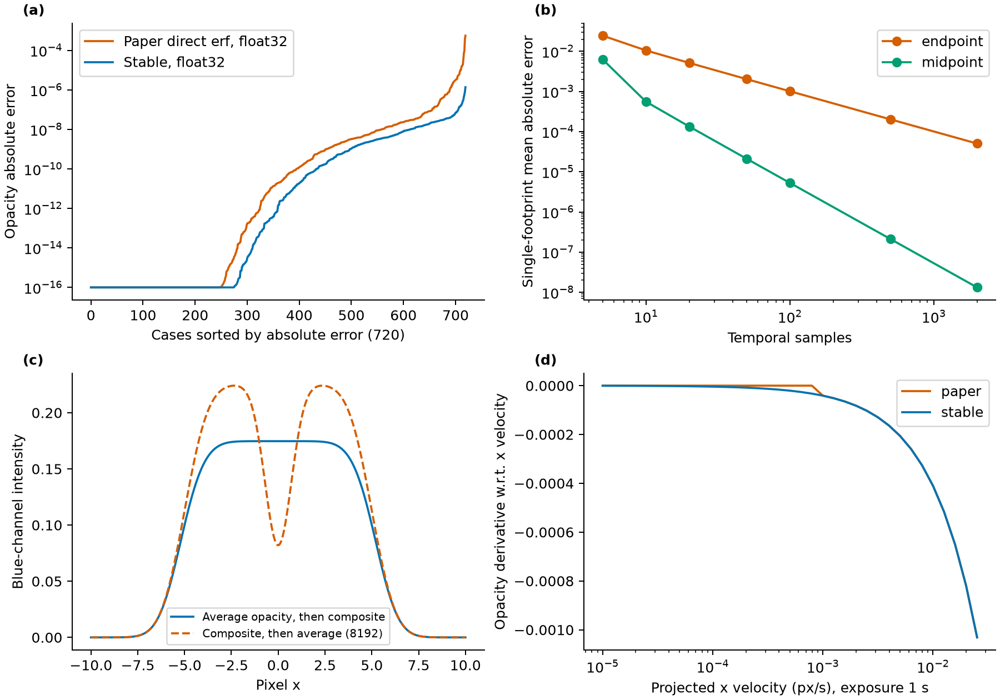
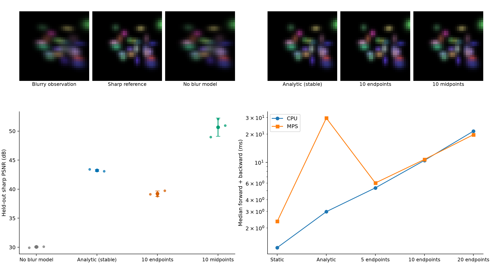

# RoMo-GS 核心算法复现：第一阶段结果

审阅日期：2026-11-17。独立实现，作者算法代码尚未发布；没有复现论文整套系统或任何完整结果表。

## 核心数值核验

- 720 组积分测试，3 个随机种子；稳定版 float64 最大绝对误差 2.109e-15，float32 1.362e-06。参考为独立 SciPy 自适应积分，在最接近像素的时刻分段。
- 24 组、每组 9 个参数的梯度核验：对独立积分做中心有限差分，最大绝对误差 6.855e-11。另有 5 项单元测试，包括投影速度对真实 SE(3) 微扰的有限差分。
- 原论文式 direct-erf + 静止分支也保留：float32 最大误差 5.542e-04；稳定版是明确标识的数值扩展，没有静默替换后声称逐字复现。
- 224 组近零速度/曝光扫描中，值与梯度均有限。CPU/MPS 输出最大差 4.470e-07；五组输入梯度最大差 1.698e-06。

图：左上为720组绝对误差的排序分布；右上为单高斯积分的端点/中点采样收敛；左下是两层高不透明度遮挡的蓝通道；右下为静止分支附近的速度梯度。所有图来自本地计算，不是论文图。

## 多采样与合成近似

论文 Eq.4 精确积分每个高斯的不透明度，而 Eq.2 在每个时刻完成透明度合成后才平均。二者一般不交换；增加采样数无法消除解析模型的这项近似。
- 两个反向运动、高不透明度（0.9）的重叠高斯：与8192次中点积分的颜色最大差 0.092675（RGB范围0–1）；低不透明度0.1时为 0.001144。
- 单高斯等权端点采样严格遵循论文 Eq.2；另外报告中点规则，避免把端点离散偏差当作解析模型的普遍优势。5/10/20/50/100/500/2000采样的完整误差见 core_summary.json。

## Mac 小规模重建

固定一个程序生成场景（场景种子20261117），24个高斯、32×32图像、9个位姿：6个训练视图，3个清晰留出视图。每个方法在种子0/1/2下运行240步，CPU与MPS共24次训练。数据完全本地生成，不涉及下载或分发第三方图像。

模糊观测由64节点Gauss–Legendre积分的完整三维相机平移渲染生成，并非解析模型自生成标签。全9视图与128节点对照的最大像素差为 3.576e-07。已知相机、速度与高斯对应关系，初始化由GT位置加0.05单位噪声；优化位置、对角尺度、颜色和不透明度。世界坐标单位是程序场景单位，不作米制精度声明。

| 设备 | 模型 | 清晰留出PSNR，均值±样本标准差(dB) | 匹配高斯位置RMSE | 240步耗时(s) |
|---|---|---:|---:|---:|
| CPU | No blur model | 30.062 ± 0.090 | 0.04107 ± 0.01511 | 0.451 ± 0.008 |
| CPU | Analytic (stable) | 43.452 ± 0.400 | 0.01333 ± 0.00136 | 0.828 ± 0.015 |
| CPU | 10 endpoints | 39.312 ± 0.425 | 0.02384 ± 0.00132 | 2.742 ± 0.044 |
| CPU | 10 midpoints | 49.700 ± 1.720 | 0.00989 ± 0.00238 | 2.780 ± 0.080 |
| MPS | No blur model | 30.066 ± 0.104 | 0.04037 ± 0.01672 | 1.308 ± 0.538 |
| MPS | Analytic (stable) | 43.225 ± 0.159 | 0.01422 ± 0.00302 | 8.593 ± 0.622 |
| MPS | 10 endpoints | 39.234 ± 0.481 | 0.02418 ± 0.00120 | 2.951 ± 0.054 |
| MPS | 10 midpoints | 50.674 ± 1.568 | 0.00863 ± 0.00075 | 3.619 ± 1.258 |

图：上排是MPS种子0的第一个留出视图（view2），以最近邻放大32×32像素；左下显示全部3个种子的PSNR与样本标准差；右下是24高斯、32×32、同步计时、5次预热/20次重复、仅对位置求梯度的前后向中位耗时，CPU使用1线程。计时仅适用于当前通用PyTorch实现。

**观察：** 解析模型明显优于不处理模糊与10次端点采样，但10次中点采样取得更好的清晰图像质量。解析模型在CPU上更省时，在当前MPS实现上反而慢于10次采样。CPU/MPS的长程优化结果有差异；单步值与梯度接近不意味着整个非凸优化轨迹相同。没有实现融合Metal/CUDA内核，不能据此支持或否定论文A6000的速度结论。

## 范围、假设与未完成项

- 已实现：曝光积分、原式与稳定版、投影速度、全SPD三维协方差投影、前后透明度合成、端点/中点采样与已知相机的小规模三维参数优化。
- 尚未实现：ORB-SLAM3/MODP前端、在线关键帧调度、相机状态联合优化训练、LM精修、逐像素敏感度剪枝、增密、AccuTile与CUDA/Metal融合内核。投影支持角速度，但本次重建只有平移；未覆盖大旋转、遮挡排序变化和运动中的协方差变化。
- 已知GT数量和对应关系、接近GT的初始化，是受控可行性验证，不是从原始RGB视频完整建图，也不是实际机器人数据评估。没有PSNR与论文表格数值匹配声明。
- 透明度上限采用0.999，屏幕低通方差0.3 px²；无tile裁剪、早停或梯度截断。训练采用0.8 L1 + 0.2(1–SSIM)，SSIM为7×7均匀有效窗口，与作者未公开实现不保证一致。
- 完整代码、生成数据、训练日志和参数文件保存在本地独立项目。总览只发布已审阅的标量结果与自生成图，不代表单篇实现已公开。

## 下一阶段判断

CPU足以支持当前核心验证和玩具规模优化，Mac GPU可运行且梯度核验通过。进一步扩大真实场景前，应先实现分块/融合渲染并测量容量与耗时，再接入公开RGB-D数据与真实位姿；当前结果不足以承诺Mac上的在线速度。

## 证据索引

- `results/core/core_raw.json`：全部积分参数、参考值与梯度；`core_summary.json`：门限与采样收敛。
- `results/limits_audit.json`：近零扫描和观测积分收敛；`results/device_audit.json`：CPU/MPS值、梯度和逐次计时。
- `results/aggregate.json`：24次训练记录与聚合；`pilot_cpu/`、`pilot_mps/`、`midpoint_cpu/`、`midpoint_mps/`：每步日志和24个完整参数存档。
- `results/pilot_scene.npz`：全部程序场景参数、位姿、清晰图和模糊观测；`scripts/replay.py`从保存参数独立重渲染核查。
- `results/environment.json`及`results/manifest.json`：环境与SHA-256；`paper/source.json`：原文固定版本来源。
